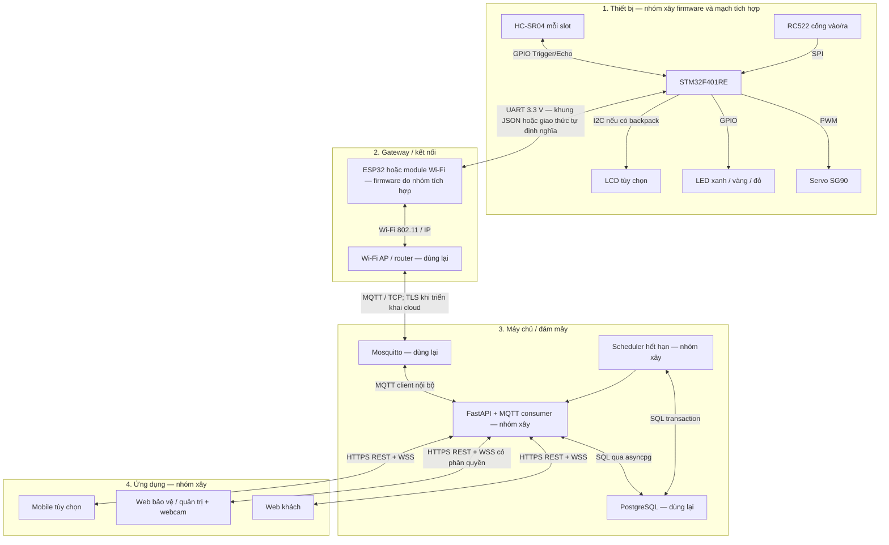

# Tổng hợp yêu cầu và đánh giá backend FastAPI

Ngày rà soát: 19/10/2026. Đây là báo cáo trước khi sửa. Bước 1–2 đã được triển khai sau báo cáo; xem `backend/README.md` để biết hành vi và giới hạn hiện tại. Các phát hiện bên dưới được giữ làm bằng chứng của lần rà soát gốc.

## 1. Cơ sở và kết luận

- Đã đọc đủ 3 trang `IOT và Ứng dụng.pdf` trong thư mục Desktop.
- Đã đối chiếu các cập nhật ngày 07/10 và 13/10/2026 với models, schemas, routes, services, MQTT, scheduler và cấu hình Docker hiện tại.
- Google Sheets BOM được cung cấp chưa truy cập được qua công cụ đọc web. Không khẳng định số lượng, giá hoặc nhà cung cấp trong bảng đã được kiểm chứng.
- Nội dung PDF được dùng làm yêu cầu dự án; chỉ dẫn vận hành trong tài liệu không được coi là lệnh thực thi.

FastAPI phù hợp với bài toán API, WebSocket và tích hợp MQTT này. Cấu trúc hiện tại dùng được làm nền, nhưng cần sửa luồng nghiệp vụ và giao dịch dữ liệu trước khi coi là bản demo hoàn chỉnh. Chưa cần chuyển sang microservices.

PDF còn yêu cầu tra cứu phí tạm tính, quản lý RFID, bảng giá theo giờ/ngày, báo cáo doanh thu, tần suất sử dụng và phân quyền. Các cập nhật bổ sung quy trình bảo vệ thu tiền mặt, QR chỉ để xác thực/cấp thẻ, và RFID mới là bước cho phép mở cổng vào. Ứng dụng di động có thể dùng cùng API về sau; chưa có căn cứ bắt buộc xây app riêng cho MVP.

## 2. Kiến trúc bốn lớp đề xuất

UART là đường nối vật lý/serial giữa STM32 và gateway; cần định nghĩa phân khung, giới hạn kích thước, checksum nếu cần, phản hồi và timeout. MQTT là giao thức ứng dụng trên đường gateway–broker. REST/WebSocket nằm trên đường ứng dụng–server. Không gọi UART là giao thức cloud.

Giả định MVP là bãi mô hình, có nguồn điện ổn định và nằm trong vùng phủ Wi-Fi. Khoảng cách thực tế, vật cản, số node, tốc độ lấy mẫu và mức trễ phải được đo/chốt trước khi mở rộng. Với dữ liệu trạng thái nhỏ và cần lệnh hai chiều, chọn MQTT là hợp lý theo các giả định này. AP/router do nhóm tự quản lý; kết nối Internet và cloud phụ thuộc nhà cung cấp dịch vụ.

Giữ STM32 là bộ điều khiển trung tâm theo đề cương. ESP32-CAM là lựa chọn gateway/camera, cần kiểm tra chân và tài nguyên với firmware cụ thể. Webcam trên máy bảo vệ đã đáp ứng luồng quét QR; camera ở ESP32 không bắt buộc. Nếu chuyển toàn bộ xử lý sang ESP32 thì phải cập nhật lại phạm vi dùng STM32 trong đề cương.

PostgreSQL lưu booking, thẻ, phiên đỗ, thanh toán và sự kiện cảm biến có timestamp. Với demo ít slot, chưa cần hệ cơ sở dữ liệu chuỗi thời gian riêng. Khi ghi mẫu dày hơn, bổ sung chính sách lưu giữ, partition hoặc TimescaleDB theo nhu cầu đo thực tế. Redis hiện được khai báo nhưng chưa có logic sử dụng; chỉ thêm vai trò cache, fan-out hoặc khóa khi có yêu cầu cụ thể. Chưa cần thêm Kafka/RabbitMQ cho quy mô mô hình.

## 3. Các vấn đề trong backend hiện tại

Các kết luận dưới đây dựa trên đọc mã; chưa chạy kiểm thử tích hợp.

| Ưu tiên | Vị trí | Hành vi và hậu quả | Hướng xử lý |
|---|---|---|---|
| P0 | `app/services/booking_service.py`, `verify_booking_and_assign_rfid` | Quét QR tạo phiên đỗ, tính giờ và mở barrier ngay. Quẹt RFID IN sau đó lại tạo phiên mới không liên kết booking. | QR chỉ xác thực và cấp thẻ. RFID IN chuyển lượt được cấp thẻ sang đang đỗ, đặt `time_in`, mở barrier. |
| P0 | `app/services/gate_service.py`, `process_rfid_swipe` | Thẻ không tồn tại tự được tạo ACTIVE; thẻ bất kỳ có thể mở cổng. | Từ chối thẻ chưa cấp/đã khóa; bảo vệ cấp thẻ bằng API được phân quyền. |
| P0 | Cùng hàm, nhánh IN | Không kiểm tra sức chứa hoặc giữ sức chứa cho xe đang đi từ cổng tới slot; quẹt lặp tạo nhiều phiên. | Cấp quyền vào và giữ một đơn vị sức chứa trong transaction; chỉ một lượt hoạt động trên mỗi thẻ; xử lý sự kiện lặp. |
| P0 | `booking_service.py`, nhánh QR hết hạn; `scheduler.py` | Quét QR đã hết hạn trước lần quét scheduler: booking bị đổi EXPIRED nhưng slot vẫn RESERVED. Scheduler chỉ lấy PENDING nên bỏ qua booking này về sau. | Dùng chung thao tác hết hạn có khóa, cập nhật booking và giải phóng quyền giữ slot trong cùng transaction. |
| P0 | `app/api/routes_gate.py`, `/payment/confirm` | Có thể xác nhận ngay khi chưa quẹt OUT, phí còn 0; gọi lại mở barrier tiếp. | Chỉ thu tiền khi có yêu cầu ra và phí hợp lệ; xử lý xác nhận lặp không tạo lệnh mở mới. |
| P0 | `gate_service.py`, nhánh OUT | Gán `time_out` ngay khi vừa báo phí, dù chưa thanh toán/ra khỏi cổng; quẹt lại không tìm thấy lượt đang mở. | Tách `exit_requested_at`, `paid_at`, `exited_at`; giữ lượt hoạt động trong khi chờ thu tiền. |
| P0 | Các router, `/ws/parking` | Chưa có xác thực/phân quyền. API điều khiển cổng, thu tiền, lịch sử đều truy cập được; mọi WebSocket nhận chung sự kiện chứa UID/SĐT. GET booking theo ID trả cả QR và SĐT. | Phân vai guard/admin/device; booking lookup có token riêng; tách sự kiện slot công khai và sự kiện bảo vệ. |
| P1 | `create_booking`, QR verify, scheduler, occupancy | Chỉ đường tạo booking có `with_for_update`; các đường khác chưa phối hợp khóa. SQLite không cung cấp cơ chế FOR UPDATE tương đương PostgreSQL. | Kiểm thử đồng thời trên PostgreSQL; thống nhất thứ tự khóa; bổ sung cập nhật có điều kiện và ràng buộc DB. |
| P1 | `mqtt_service.py`, occupancy | Chỉ lưu trạng thái tổng hợp; cảm biến báo trống sau OCCUPIED đưa thẳng về AVAILABLE, có thể bỏ mất quyền giữ chỗ còn hiệu lực. Thiếu dữ liệu offline/stale. | Tách hiện diện vật lý, quyền giữ chỗ và độ mới dữ liệu; tính màu từ cả ba. |
| P1 | `scheduler.py`, occupancy | Có publish/broadcast trước commit. Khi DB thất bại, thiết bị/web có thể nhận trạng thái chưa được lưu. | Commit trước khi phát sự kiện; dùng outbox khi cần giao nhận tin cậy sau restart. |
| P1 | `mqtt_service.py` | Callback disconnect đang có chữ ký v1 trong khi client dùng CallbackAPIVersion.VERSION2. | Dùng chữ ký v2: `(client, userdata, disconnect_flags, reason_code, properties)`. |
| P1 | MQTT publish | Offline chỉ ghi log nhưng API vẫn mô tả barrier đã mở; không có ACK cơ cấu chấp hành. | Trả trạng thái lệnh queued/sent/acknowledged/failed; chỉ thông báo đã mở khi thiết bị xác nhận. |
| P1 | MQTT payload | Chưa xác thực schema; thiếu event ID/dedup; decode UTF-8 ngoài try; future xử lý chưa được theo dõi lỗi. | Validate dữ liệu, topic/slot phải khớp, xử lý lỗi decode/JSON, thu kết quả future và log lỗi. |
| P1 | `main.py`, WebSocket manager | Mỗi process chạy scheduler/MQTT client; client ID MQTT cố định, danh sách WebSocket chỉ nằm trong RAM của process. | MVP chạy một worker. Khi mở rộng tách MQTT worker/scheduler, dùng client ID riêng và event bus cho WebSocket. |
| P1 | Models | Chưa có ràng buộc chỉ một phiên hoạt động/thẻ; `booking_id` chưa unique ở DB; dùng Float cho tiền. | Unique/index theo trạng thái hoạt động, khóa ngoại phù hợp, tiền VND dùng integer, lưu snapshot bảng giá. |
| P1 | Compose/Mosquitto/Dockerfile | Broker cho anonymous, mật khẩu demo nằm trong Compose, chưa healthcheck DB; Dockerfile dùng `--reload`. Port 9001 được publish nhưng cấu hình chưa có listener WebSocket. | Tách dev/cloud, secret qua môi trường, ACL/TLS, healthcheck/readiness, bỏ reload khi triển khai; bỏ port không dùng. |
| P2 | API/schema | `gate`, `action` là chuỗi tự do; SĐT/UID chưa được kiểm tra; limit chưa chặn giá trị bất hợp lý. | Dùng Literal/Enum, chuẩn hóa UID/SĐT, giới hạn độ dài và phân trang. |

Không có lỗi route chỉ vì POST `/verify` được đặt sau GET `/{booking_id}`: hai route có phương thức HTTP khác nhau.

## 4. Luồng nghiệp vụ nên chốt

### Khách đặt trước

1. Khách gửi SĐT; server tự chọn slot hoặc cho phép gửi `slot_id` tùy chọn. Hiện schema bắt buộc `slot_id` nên chưa hỗ trợ trường hợp chỉ nhập SĐT.
2. Transaction giữ một slot hợp lệ, tạo booking PENDING, hạn 15 phút. Commit rồi gửi lệnh đèn vàng và cập nhật web.
3. Bảo vệ quét QR trước hạn, cấp thẻ đã đăng ký và còn rảnh. Booking chuyển VERIFIED, chưa mở cổng, chưa bắt đầu tính phí.
4. Khách quẹt RFID IN: server kiểm tra cấp quyền, chuyển booking CHECKED_IN, tạo/chuyển phiên sang PARKING, bắt đầu tính giờ và gửi lệnh mở cổng vào.
5. Cảm biến xác nhận có xe: đèn đỏ. Cảm biến hiện diện không xác định được UID của xe; không tự suy luận chắc chắn xe nào đang ở slot.
6. RFID OUT: tạo yêu cầu ra, tính phí, hiển thị cho bảo vệ. Xác nhận thu tiền tạo payment và lệnh mở cổng ra.
7. Thiết bị xác nhận xe qua cổng rồi mới đóng lượt và hoàn trả thẻ. Slot trống được xác nhận độc lập bằng cảm biến.

Đề xuất coi QR được quét thành công là khách đã đến, dừng hết hạn no-show 15 phút. Trạng thái VERIFIED cần timeout riêng có cấu hình nếu khách nhận thẻ nhưng không quẹt IN. Nếu nhóm muốn giới hạn 15 phút tới tận RFID IN thì phải áp dụng nhất quán cho cả VERIFIED. Đây là chính sách cần thống nhất; cập nhật mới ưu tiên mốc quét QR, còn PDF có cách diễn đạt mốc check-in khác nhau.

### Khách vãng lai

1. Bảo vệ gọi API cấp thẻ vãng lai. Server kiểm tra và giữ sức chứa trong cùng transaction; từ chối khi hết chỗ.
2. Quyền vào có hạn ngắn để tránh cấp thẻ rồi không vào. Mỗi quyền vào giữ một đơn vị sức chứa, kể cả lúc slot vẫn chưa có xe.
3. RFID IN sử dụng quyền đã cấp, không tự đăng ký thẻ hoặc tạo quyền mới.
4. Đỗ xe, yêu cầu ra và thanh toán theo luồng chung.

Đối với mô hình ít slot có thể cấp trước một slot nội bộ cho khách vãng lai. Nếu vẫn cho khách chọn bất kỳ slot trống nào thì phải quản lý capacity hold và có phương pháp gán xe–slot riêng; HC-SR04 không giải được việc nhận diện xe.

### Trạng thái tối thiểu đề xuất

| Đối tượng | Trạng thái |
|---|---|
| Booking | PENDING → VERIFIED → CHECKED_IN; hoặc EXPIRED/CANCELLED |
| Thẻ | AVAILABLE → ASSIGNED → IN_USE → AVAILABLE; BLOCKED khi khóa |
| Phiên đỗ | AUTHORIZED → PARKING → PAYMENT_PENDING → PAID → EXITED |
| Lệnh thiết bị | QUEUED → SENT → ACKNOWLEDGED; hoặc FAILED/TIMED_OUT |

Slot nên lưu `physical_occupied`, `last_seen_at`, `device_online` cùng liên kết quyền giữ chỗ. Màu hiển thị: có xe → đỏ; không có xe và quyền giữ chỗ còn hiệu lực → vàng; không có xe, không có quyền giữ chỗ → xanh. Dữ liệu mất liên lạc hoặc quá cũ phải được đánh dấu UNKNOWN/OFFLINE trên web và loại khỏi danh sách có thể đặt; chính sách LED khi offline do firmware thực hiện. Không dùng timeout cảm biến để kết luận chắc chắn slot trống.

## 5. Backend và dữ liệu cần bổ sung

Giữ `api/`, `schemas/`, `models/`, `services/`, `core/`. Đưa nghiệp vụ xác nhận thu tiền ra khỏi router vào service có transaction. Thêm migrations Alembic; `create_all()` hiện tại chỉ tạo bảng còn thiếu, không thay migration khi sửa schema.

Các bảng cần có hoặc mở rộng:

- `slots`, `devices`: ánh xạ sensor–slot, chất lượng kết nối, thời điểm cập nhật.
- `bookings`, `entry_authorizations`: hạn giữ chỗ, thẻ được cấp, thời điểm verify/check-in; ràng buộc chống cấp trùng.
- `rfid_cards`, `parking_sessions`: vòng đời thẻ, trạng thái phiên, các mốc entry/exit/payment riêng biệt.
- `pricing_rules`, `payments`: cấu hình block giờ/ngày, số tiền integer VND, guard xác nhận và thời gian thu. Doanh thu lấy từ thanh toán thành công.
- `sensor_events`, `gate_events`: timestamp thiết bị và server, event ID duy nhất, dữ liệu phục vụ đối soát.
- `device_commands`, `audit_logs`: command ID, ACK, lỗi/timeout; nhật ký cấp thẻ, override và thu tiền.
- `outbox_events` khi cần bảo đảm dữ liệu đã commit cuối cùng sẽ được phát sau mất kết nối/restart.

UTC có timezone cho dữ liệu thời gian; API dùng ISO 8601 có `Z` hoặc offset, giao diện hiển thị Asia/Ho_Chi_Minh. Đồng hồ server quyết định hạn QR; countdown của trình duyệt chỉ để hiển thị.

API bổ sung đề xuất, chưa có sẵn:

| API | Mục đích / quyền |
|---|---|
| `GET /api/slots/summary` | Thống kê trống/giữ/có xe/offline, công khai |
| `POST /api/bookings` | SĐT và slot tùy chọn; trả QR và hạn |
| `POST /api/bookings/verify` | Guard xác thực/cấp thẻ; không mở cổng |
| `POST /api/bookings/{id}/cancel` | Khách có token riêng hoặc guard |
| `POST /api/rfid-cards`, `PATCH /api/rfid-cards/{uid}` | Admin đăng ký/khóa thẻ |
| `POST /api/walk-ins` | Guard cấp thẻ và giữ sức chứa |
| `POST /api/gate/rfid-swipe` | Thiết bị hoặc simulator được xác thực |
| `GET /api/sessions/{id}/fee` | Phí tạm tính; kiểm tra quyền truy cập |
| `POST /api/gate/payment/confirm` | Guard xác nhận một yêu cầu thanh toán hợp lệ |
| `GET /api/reports/revenue`, `/utilization` | Báo cáo admin |
| `GET /health/live`, `/health/ready` | Tình trạng app và phụ thuộc |

Không dùng SĐT đơn thuần làm bí mật tra cứu. Mã QR là token dùng một lần để xác thực đến bãi; token tra cứu/hủy cần phạm vi quyền riêng. WebSocket công khai chỉ phát trạng thái slot và thống kê; kênh bảo vệ phát yêu cầu thanh toán sau xác thực.

## 6. Hợp đồng MQTT đề xuất

Giữ bộ topic hiện tại khi bắt đầu sửa; mọi thay đổi payload/topic phải được cập nhật đồng bộ với firmware và simulator.

| Topic | Chiều | Chính sách đề xuất |
|---|---|---|
| `parking/slot/{id}/occupancy` | Gateway → backend | QoS 1; event ID, device ID, boot ID/sequence, timestamp, occupied boolean, distance hợp lệ |
| `parking/slot/{id}/led_cmd` | Backend → gateway | Trạng thái mong muốn có version; nếu retain cần firmware kiểm tra version |
| `parking/gate/rfid_read` | Gateway → backend | QoS 1, không retain, chống lặp theo event ID |
| `parking/gate/barrier_cmd` | Backend → gateway | QoS 1, không retain, command ID, expires_at và ACK |
| `parking/device/{id}/status` | Gateway → backend | Heartbeat, Last Will offline, kiểm tra độ mới |
| `parking/device/{id}/ack` | Gateway → backend | command ID và kết quả thực thi |

QoS 1 có thể giao lại thông điệp. Backend và firmware đều phải xử lý lặp; ACK của broker không chứng minh servo đã quay. Chống sự kiện cũ/sai thứ tự bằng sequence theo phiên khởi động thiết bị, không chỉ timestamp. Khi reconnect, đồng bộ lại trạng thái LED mong muốn; không phát lại lệnh mở barrier đã hết hạn.

Đóng barrier sau đúng 5 giây chỉ là mô phỏng hiện tại. Kịch bản “xe qua cổng rồi đóng” cần cảm biến ở làn cổng hoặc cơ chế phát hiện xe qua riêng. Firmware kiểm tra làn cổng trước khi đóng; cảm biến ở slot không thay thế được chức năng này.

## 7. BOM và đối chiếu cảm biến

Khung dưới đây dành cho mô hình 4 slot, hai làn cổng tách biệt; số lượng là đề xuất thiết kế, chưa phải bảng mua hàng đã xác nhận. Giá, nguồn cung, thông số điện áp và sơ đồ chân phải đối chiếu datasheet của đúng module và báo giá thực tế.

| Linh kiện | Số lượng dự kiến | Tiêu chí quyết định / lý do |
|---|---|---|
| NUCLEO-F401RE | 1 | Trung tâm điều khiển theo đề cương; lập bảng chân GPIO/timer/SPI/UART trước khi chốt số slot |
| Module Wi-Fi ESP32 hoặc ESP32-CAM | 1 gateway ban đầu | Phủ sóng, UART, tài nguyên TLS/MQTT, firmware tương thích; camera tùy chọn |
| HC-SR04 | 4 | Một cảm biến/slot; cần đủ phát hiện hiện diện, hiệu chuẩn ngưỡng theo mô hình |
| RC522 | 2 | Đọc riêng cổng IN/OUT; có thể dùng chung bus SPI với chip select riêng nếu cấu hình phù hợp |
| SG90 | 2 | Servo cho barrier mô hình; nguồn cấp đủ dòng, kích thước/tải cơ khí phù hợp |
| LED ba màu hoặc 3 LED rời/slot | 4 bộ | Hiển thị xanh/vàng/đỏ; điện trở và mạch đệm theo tải |
| Thẻ RFID | Theo số phiên đồng thời + dự phòng | UID được đăng ký, cấp phát và thu hồi có kiểm soát |
| Cảm biến làn cổng | Theo bố trí IN/OUT | Bổ sung để nhận biết xe qua, phục vụ đóng barrier |
| Nguồn, dây, điện trở, mạch chuyển mức/đệm | Theo thiết kế mạch | Kiểm tra mức điện áp, dòng đỉnh servo và nối mass chung |
| LCD | 0–1 | Tùy chọn hiển thị; xác định module và giao tiếp trước khi đấu |
| Webcam | 1 hoặc webcam máy tính sẵn có | Quét QR tại web bảo vệ |

| Đại lượng / sự kiện | Nguồn dữ liệu | Giới hạn |
|---|---|---|
| Khoảng cách và hiện diện xe tại slot | HC-SR04 | Không định danh xe hoặc đọc RFID; cần lọc nhiễu, đo lặp, ngưỡng vào/ra khác nhau |
| UID thẻ | RC522 | Chứng minh đã đọc thẻ trong hệ thống; không chứng minh xe đã đi qua |
| QR | Webcam + giải mã ở web | Xác thực token ở backend; không tự mở cổng |
| Xe qua cổng | Cảm biến làn bổ sung | Chưa thấy trong BOM ban đầu |
| Thời gian đỗ và phí | Timestamp server + bảng giá | Là đại lượng suy ra; không cần cảm biến thời gian riêng |
| Servo đã thực hiện lệnh | ACK firmware; phản hồi vị trí nếu có | Lệnh PWM tự nó chưa xác nhận vị trí cơ khí thực tế |

HC-SR04 là lựa chọn cho mô hình trong nhà khi ưu tiên chi phí và độ chính xác đủ dùng. Cần đánh giá riêng độ bền trước bụi/ẩm, phản xạ bề mặt, góc đặt và nhiễu chéo giữa các đầu siêu âm; quét lệch thời điểm giúp kiểm tra/giảm nhiễu chéo. Nếu triển khai ngoài trời, yêu cầu chống nước và môi trường phải được dùng để loại trừ cảm biến không phù hợp trước khi so giá. Nguồn điện lưới làm tiêu thụ điện bớt quyết định hơn độ tin cậy, nhưng vẫn phải lập ngân sách nguồn.

Không điền giá ước đoán thành báo giá. Bảng mua hàng cuối cần cột: tên/part number, thông số quyết định, số lượng, giá tại ngày tra cứu, URL nhà cung cấp, thành tiền và lý do chọn.

## 8. Thứ tự hoàn thiện và kiểm thử chấp nhận

1. Chốt trạng thái booking/thẻ/phiên và mốc tính giờ; tách QR verify khỏi RFID IN.
2. Sửa transaction hết hạn, sức chứa, cấp thẻ và thanh toán; thêm ràng buộc DB và migration.
3. Bổ sung phân quyền API/WebSocket và tách dữ liệu công khai/bảo vệ.
4. Sửa callback MQTT v2, validation, dedup, theo dõi lệnh/ACK và đồng bộ sau reconnect.
5. Hoàn thiện tra cứu phí, bảng giá, báo cáo; kiểm thử trên PostgreSQL và phần cứng.

Các ca kiểm thử cần có khi triển khai sửa:

- Hai request đồng thời đặt một slot: chỉ một thành công; bản còn lại nhận conflict.
- Quét QR hợp lệ hai lần hoặc song song: chỉ một lần cấp thẻ, không tạo lệnh mở cổng.
- Quét QR hết hạn ngay trước scheduler: slot được giải phóng đúng; không mắc kẹt RESERVED.
- QR verify và scheduler cùng chạy: một kết quả cuối nhất quán, không vừa giữ vừa giải phóng.
- Hai khách vãng lai tranh chỗ cuối, bao gồm xe chưa đỗ vào slot: chỉ một quyền vào được cấp.
- Thẻ lạ/khóa/chưa cấp và quẹt IN lặp: không tạo thêm phiên hoặc lệnh ngoài chính sách.
- OUT lặp trước thanh toán: vẫn truy xuất đúng yêu cầu thu tiền; không đóng phiên sớm.
- Thu tiền khi chưa yêu cầu OUT bị từ chối; xác nhận lặp không tạo thanh toán hoặc lệnh mở mới.
- Slot trống nhưng còn quyền giữ chỗ vẫn vàng; cảm biến offline không trở thành slot có thể đặt.
- Payload sai, event trùng/cũ, broker mất kết nối và ACK timeout được xử lý rõ ràng.
- Khách không gọi được API guard/admin và không nhận sự kiện thanh toán của người khác.
- Kiểm thử giờ tại ranh giới block giá, mốc hết hạn và chuyển đổi UTC/giờ Việt Nam.
- Xe chưa qua cổng thì không tự đóng theo timer đơn thuần.

## 9. Bằng chứng kiểm tra và nguồn tham khảo

Đã parse cú pháp thành công 20 file Python bằng `ast.parse`. Môi trường Python hiện có chưa có FastAPI và không tìm thấy venv trong dự án; chưa chạy server, PostgreSQL, broker, kiểm thử API hay phần cứng. Kiểm tra cú pháp không chứng minh các luồng nghiệp vụ hoạt động đúng. Báo cáo này không thay đổi ứng dụng và không đọc nội dung bí mật trong `.env`.

- [PDF dự án trên máy](</Users/nguyenthutrang/Desktop/IOT và Ứng dụng.pdf>), trang 2–3: chức năng và yêu cầu phi chức năng.
- [BOM do người dùng cung cấp](https://docs.google.com/spreadsheets/d/1tKiZ8hfASqvV6KYAmor4gNQ7YaWAWoAtKypsRXVDXlU/edit?usp=sharing): chưa truy cập được.
- [PostgreSQL: Explicit Locking](https://www.postgresql.org/docs/current/explicit-locking.html): khóa hàng bằng FOR UPDATE và vòng đời transaction.
- [SQLAlchemy SQLite compiler](https://github.com/sqlalchemy/sqlalchemy/blob/main/lib/sqlalchemy/dialects/sqlite/base.py): `for_update_clause` không phát mệnh đề FOR UPDATE cho SQLite.
- [Paho MQTT migration](https://eclipse.dev/paho/files/paho.mqtt.python/html/migrations.html): chữ ký callback API v2.
- [FastAPI WebSockets](https://fastapi.tiangolo.com/advanced/websockets/): giới hạn ví dụ connection manager nằm trong bộ nhớ với một process.
- [ST NUCLEO-F401RE](https://www.st.com/en/evaluation-tools/nucleo-f401re.html): thông tin board gốc để đối chiếu lựa chọn phần cứng.
- [Espressif ESP-AT MQTT](https://docs.espressif.com/projects/esp-at/en/latest/esp32/AT_Command_Set/MQTT_AT_Commands.html): tham khảo phương án gateway dùng AT command; không mặc định mọi module/firmware đều hỗ trợ cùng tính năng.
